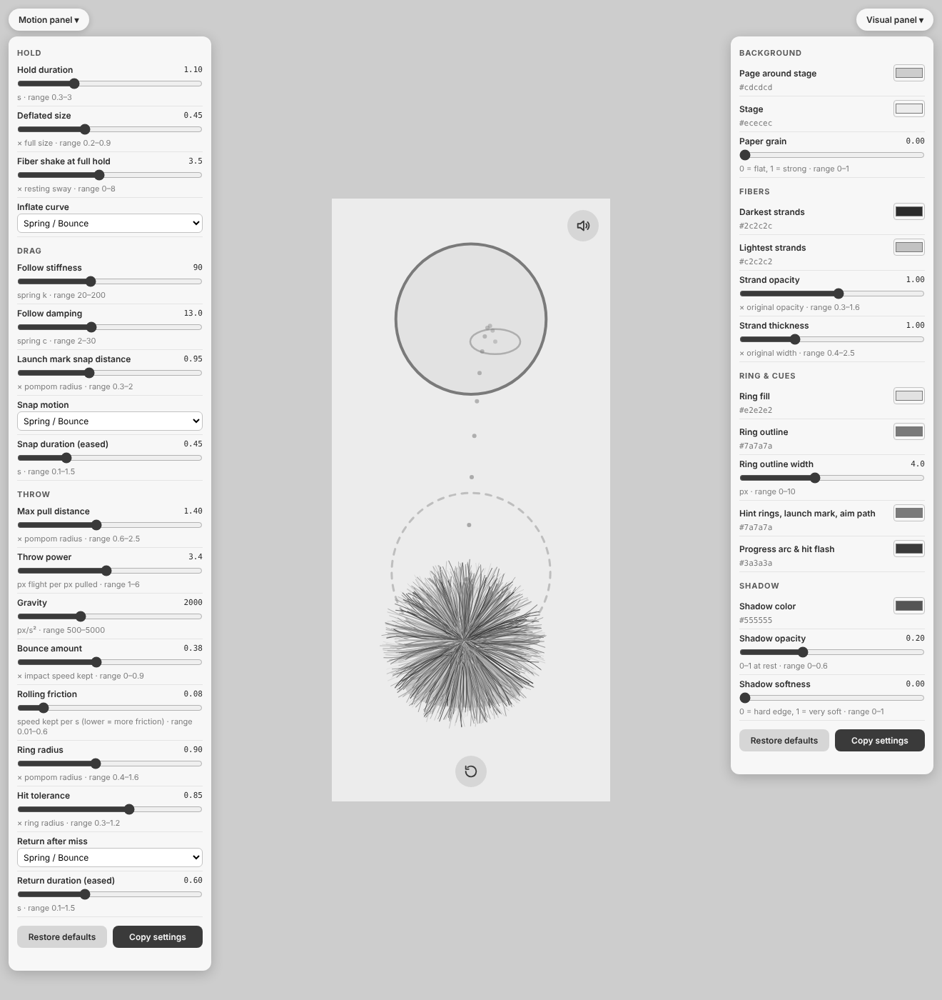
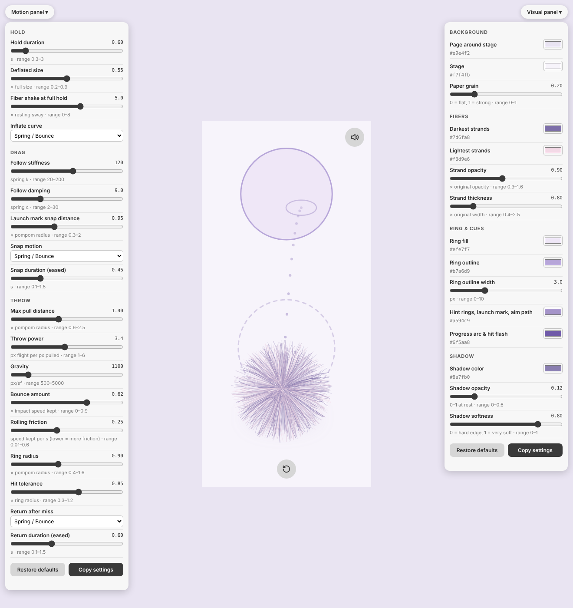
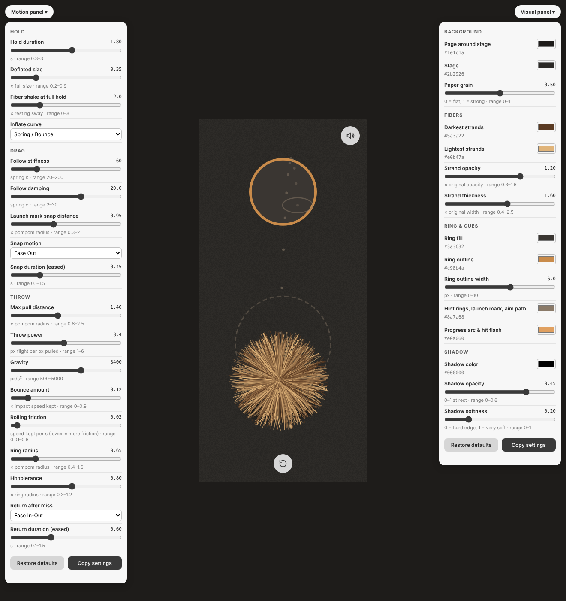

# Project 2 Process：Pompom Sequence

- **可运行网页（GitHub Pages）：** https://pikapikasilvia.github.io/sequential-interaction-project/
- **代码仓库：** https://github.com/pikapikasilvia/sequential-interaction-project
- **调参面板版本：** 在网址后面加 `?tune`，例如 https://pikapikasilvia.github.io/sequential-interaction-project/?tune （最终 demo 版本默认隐藏面板）

## 交互序列

一条线性序列，同一个毛球贯穿始终：

1. **Hold（长按）**：瘪瘪的毛球在地上微微颤动，外圈有提示光环。长按约 1.1 秒，进度环填满，纤维越抖越厉害，毛球膨胀到完整大小并"爆开"。提前松手会泄气，重来。
2. **Drag（拖动）**：Hold 完成后才能拖。把毛球拖进下方的虚线发射标记里松手，它会吸附到标记上；在别处松手则原地停留。
3. **Throw（扔）**：从发射标记往后拉，像弹弓一样瞄准，虚线点显示抛物线和落点。投进上方圆环就是结尾；投不中，毛球会滚回发射标记再试一次。

底部的 Reset 按钮随时回到 Hold 的起始状态。

## 迭代：Flick 改为 Throw

最初的第三步是 **Flick（甩）**：抓住毛球快速甩出，它在画面里二维滑行、撞墙反弹。教授指出 **Drag 和 Flick 太相似**：两者都是"按住、移动、松手"，只是松手速度不同，用户很难感受到它们是两种不同的交互。

所以第三步改为 **Throw（扔）**：

- 手势从"顺着方向甩"变成"反方向拉开再松手"（弹弓式），和 Drag 明显区分。
- 加入高度、抛物线、影子和落地弹跳，让"扔到空中"和"在地面拖动"在视觉上也不同。
- 加入明确的目标（圆环）和发射标记，Drag 的结束（放进发射标记）自然成为 Throw 的开始，序列更连贯。

## 调参面板

做了两个面板（代码保留在仓库里，最终 demo 时隐藏）：

| 面板名称 | 文件 | 内容 |
|---|---|---|
| **Motion panel**（左侧） | `docs/panel.js` | Hold 时长、瘪的大小、纤维抖动；Drag 跟随刚度和阻尼、吸附距离；Throw 最大拉动距离、力度、重力、弹跳、滚动摩擦、圆环半径、命中容差；以及动效曲线（Linear / Ease In / Ease Out / Ease In-Out / Spring） |
| **Visual panel**（右侧） | `docs/panel.js` | 背景和纸张颗粒、纤维深浅色、透明度和粗细、圆环填充和描边、提示色、影子颜色、透明度和柔和度 |

## 三组设置对比

每张截图同时显示两个面板的数值和对应的原型状态（正在瞄准 Throw 时）。

### 1. 默认手感

Hold 1.1 秒，中等力度，灰度视觉（和原始 study 一致）。

### 2. 更轻盈

Hold 缩短到 0.6 秒，重力降到 1100，弹跳增大到 0.62，拖动更跟手（刚度 120、阻尼 9）。视觉换成浅紫粉、细纤维、柔和的淡影子。

### 3. 更沉稳

Hold 拉长到 1.8 秒，重力提高到 3400，弹跳减小到 0.12，滚动摩擦增大（0.03），圆环缩小到 0.65，拖动更"重"（刚度 60、阻尼 20）。视觉换成深色背景、粗而浓的焦糖色纤维、深色硬影子。

